# 乐购·校园闲置 — Campus Flea Market

> 面向封闭校园的闲置物品交易平台，Vue 3 + Node.js + MySQL 全栈独立开发，已上线演示。


🌐 **在线体验**：<https://app.zeroly.me>

---

## 项目简介

校园场景下的二手交易平台。围绕「同校、可信、闭环」设计：

- **封闭信任圈**：仅允许校内学生凭学号注册，所有用户带学院标签
- **上架前审核**：商品发布后必须经管理员审核才能在「逛市场」曝光，杜绝违规/虚假信息
- **状态化订单**：买家下单 → 卖家确认 → 买家当面确认收货 → 完成，状态机驱动，避免纠纷
- **三件套安全**：RSA 非对称加密登录密码 → JWT 鉴权 → 登录限流（10 次 / 15 分钟）

部署在阿里云 OSS（前端静态托管）+ Linux ECS（API 服务），公网直连。

---

## 核心特性

### 用户端
- 首页：搜索 + 8 大分类入口 + 最新发布瀑布流
- 逛市场：分类筛选 / 多维排序（最新、价格升降、热门）/ 价格区间
- 商品详情：大图轮播、卖家信息、联系卖家（站内信）、收藏
- 发布商品：多图上传（前端压缩 + sharp 后处理）、自动压缩至 1024px
- 我的订单：分「买到的 / 卖出的」双 Tab，状态一目了然
- 消息中心：实时站内信，未读数角标
- 收藏 / 个人资料 / 修改密码

### 管理端（独立路由 `/admin`）
- **数据看板**：注册用户、商品数、订单数、累计成交额环比 + 分类占比环形图 + 7 日增长趋势
- **用户管理**：检索、按状态启用/禁用
- **商品管理**：全量商品检索，状态切换（下架/删除）
- **订单管理**：全站订单检索，状态追踪
- **分类管理**：CRUD 分类、图标、排序

---

## 系统截图

| | |
|---|---|
| 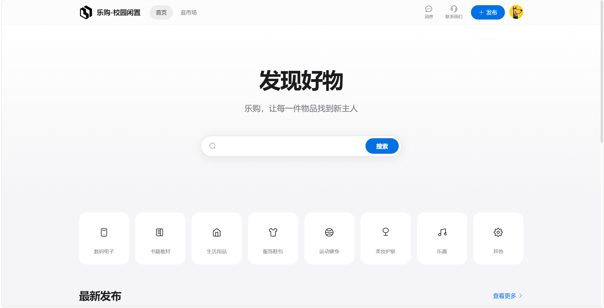 | 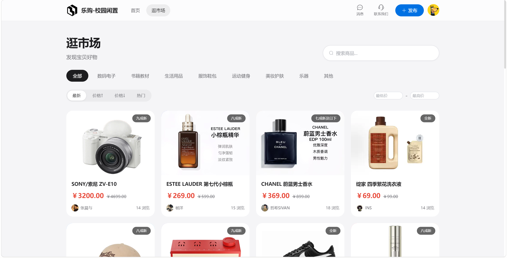 |
| **首页** | **逛市场** |
| 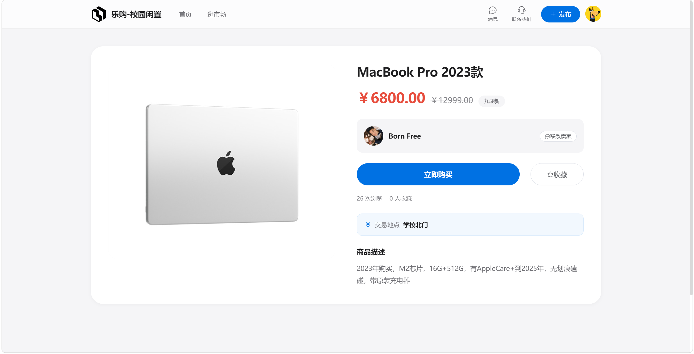 | 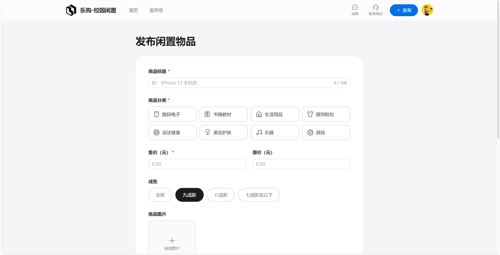 |
| **商品详情** | **发布闲置** |
| 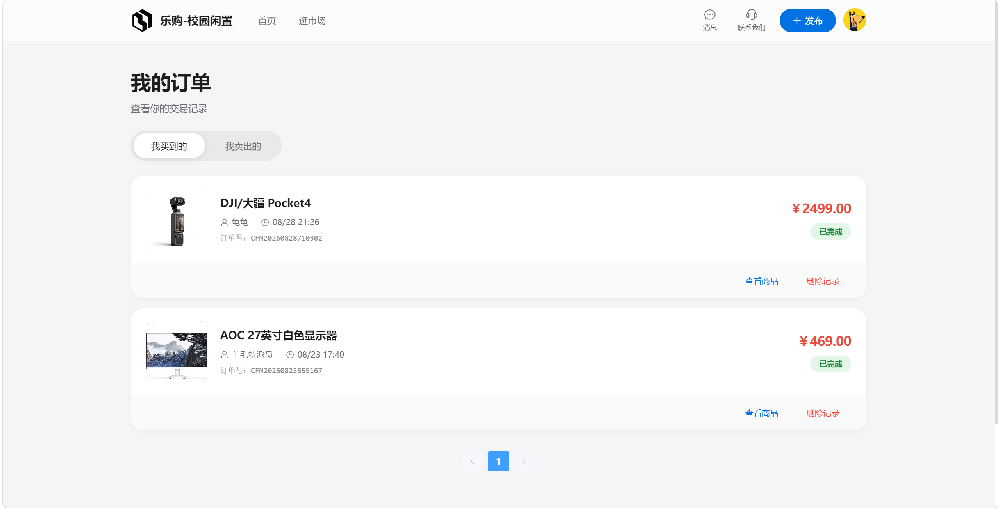 | 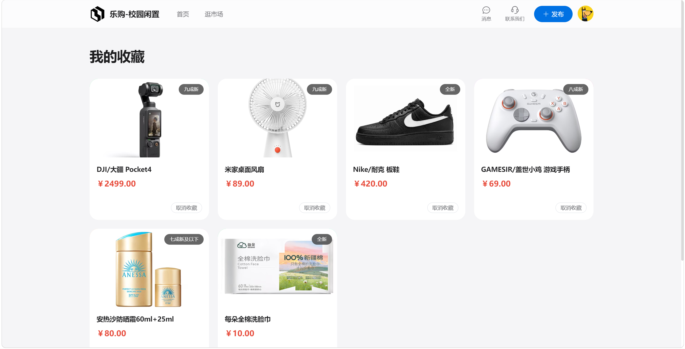 |
| **我的订单** | **我的收藏** |
| 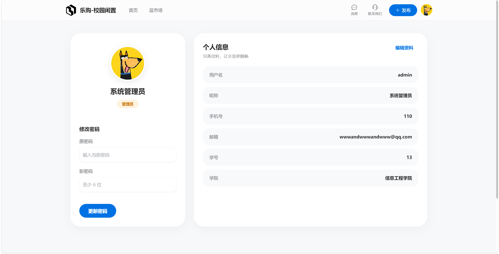 | 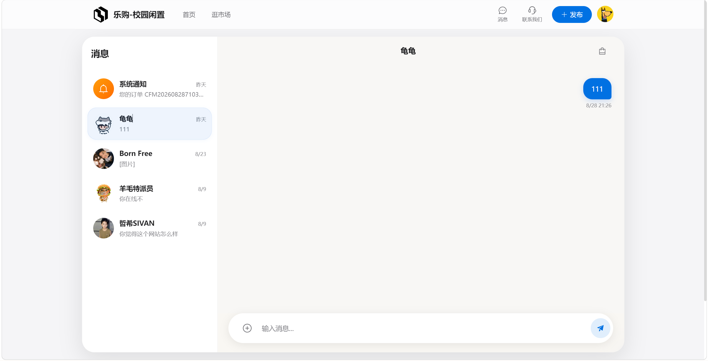 |
| **个人中心** | **消息中心** |

### 管理后台

| | |
|---|---|
| 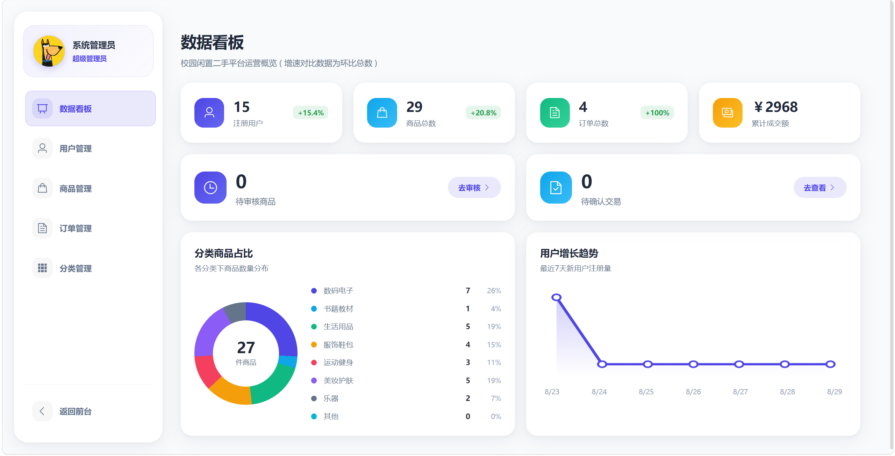 | 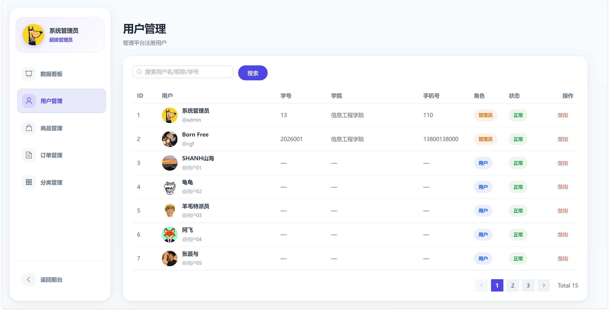 |
| **数据看板** | **用户管理** |
| 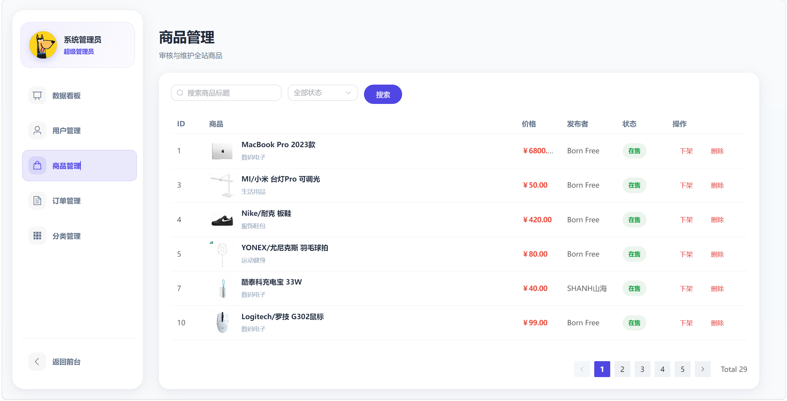 | 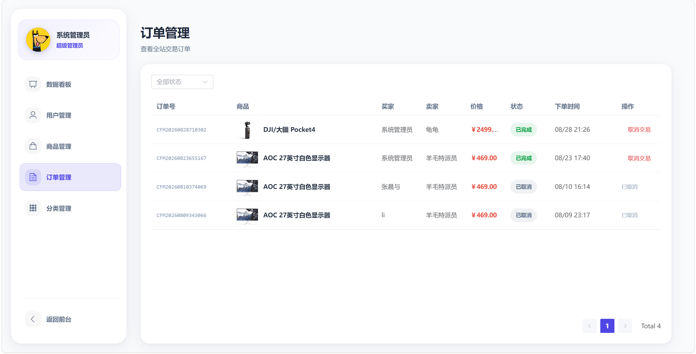 |
| **商品管理** | **订单管理** |

---

## 技术栈

### 前端（`client/`）
- **Vue 3.4** + Composition API + `<script setup>`
- **Vite 5** 构建
- **Vue Router 4** + **Pinia 2** 状态管理
- **Element Plus 2.7** UI 组件
- **Axios** HTTP 客户端，统一拦截器处理 401
- **jsencrypt** RSA 公钥加密登录密码

### 后端（`server/`）
- **Node.js 18+** + **Express 4.19**
- **Sequelize 6** + **mysql2** ORM
- **JWT**（jsonwebtoken）鉴权，载荷 `{id, username, role}`
- **bcryptjs** 密码哈希
- **multer + sharp** 文件上传 + 图片压缩
- **helmet / cors / compression / express-rate-limit** 安全与限流

### 数据库
- **MySQL 8.0**，6 张核心表（User / Product / Order / Category / Favorite / Message）

---

## 目录结构

```
campus-flea-market/
├── client/                  # 前端 (Vue 3 + Vite)
│   ├── src/
│   │   ├── views/           # 页面级组件（Home / ProductList / ...）
│   │   ├── views/admin/     # 管理后台页面
│   │   ├── router/          # 路由（含登录态守卫）
│   │   ├── stores/          # Pinia stores
│   │   ├── utils/           # axios 实例、加密工具
│   │   └── App.vue / main.js
│   ├── vite.config.js
│   └── package.json
├── server/                  # 后端 (Express)
│   ├── src/
│   │   ├── controllers/     # 8 个业务控制器
│   │   ├── models/          # Sequelize 模型定义
│   │   ├── routes/          # 路由聚合
│   │   ├── middleware/      # 鉴权、上传、限流
│   │   └── utils/           # 响应工具、数据库连接
│   ├── keys/                # RSA 公私钥（不在 git）
│   └── .env.example         # 环境变量样例
├── database/
│   └── init.sql             # 初始 schema
├── docs/screenshots/        # 截图
├── start.bat                # Windows 一键启动
├── .gitignore
└── README.md
```

---

## 快速开始

### 环境要求
- Node.js ≥ 18
- MySQL 8.0+
- npm 或 pnpm

### 1. 克隆 & 安装
```bash
git clone https://github.com/CGF-Beep/campus-flea-market.git
cd campus-flea-market

# 后端
cd server && npm install && cd ..

# 前端
cd client && npm install && cd ..
```

### 2. 初始化数据库
```bash
mysql -u root -p < database/init.sql
```

### 3. 配置环境变量
```bash
cd server
cp .env.example .env
# 编辑 .env，填入 MySQL 密码、JWT 密钥、端口等
```

### 4. 启动
```bash
# 方式一：一键启动（Windows）
双击 start.bat

# 方式二：分别启动
cd server && npm start          # 后端 → http://localhost:3000
cd client && npm run dev        # 前端 → http://localhost:5173
```

打开浏览器访问 <http://localhost:5173> 即可。

---

## 环境变量

参考 `server/.env.example`（**注意：`.env` 已被 `.gitignore` 屏蔽，私钥亦不会进入仓库**）：

| 变量 | 必填 | 说明 |
|---|---|---|
| `PORT` | ✓ | 后端监听端口，默认 3000 |
| `JWT_SECRET` | ✓ | JWT 签名密钥，**生产环境务必使用 64 位随机串** |
| `JWT_EXPIRES` | ✓ | Token 过期时间，如 `7d` |
| `DB_HOST` / `DB_PORT` / `DB_NAME` / `DB_USER` / `DB_PASSWORD` | ✓ | MySQL 连接信息 |
| `UPLOAD_DIR` | ✓ | 文件上传目录，默认 `src/uploads` |
| `CLIENT_URL` | ✓ | 前端地址，用于 CORS 与回调 |
| `TRUST_PROXY` | ✗ | 反向代理后部署时设为 `true`，否则保持 `false` |

---

## 在线演示

- 前端：<https://app.zeroly.me>
- 测试账号：登录页直接注册即可（同校信任圈，学号需 12 位、手机号 11 位 1 开头）
- 管理员账号可在数据库 `users` 表中自行将 `role` 字段改为 `admin` 后登录 `/admin`

---

## License

MIT © 2026 陈钢峰
