# 乐购·校园闲置 — Campus Flea Market

> 面向封闭校园的闲置物品交易平台，Vue 3 + Node.js + MySQL 全栈独立开发，已上线演示。


🌐 **在线体验**：<https://app.zeroly.me>

---

## 项目简介

校园场景下的二手交易平台。围绕「同校、可信、闭环」设计：

- **封闭信任圈**：仅允许校内学生凭学号注册，所有用户带学院标签
- **上架前审核**：商品发布后必须经管理员审核才能在「逛市场」曝光，杜绝违规/虚假信息
- **状态化订单**：买家下单 → 卖家确认 → 买家当面确认收货 → 完成，状态机驱动，避免纠纷
- **三件套安全**：RSA 非对称加密登录密码 → JWT 鉴权 → 登录限流（10 次 / 15 分钟）
- **数据化运营**：内置访问分析系统（来源 / 设备 / 地区 / 页面 / 实时在线），为运营决策提供依据

部署在阿里云 OSS（前端静态托管）+ Linux ECS（API 服务），Cloudflare 代理 + Nginx 反代 + HTTPS 直连。

---

## 核心特性

### 用户端
- 首页：搜索 + 8 大分类入口 + 首页轮播 Banner + 最新发布瀑布流
- 逛市场：分类筛选 / 多维排序（最新、价格升降、热门）/ 价格区间 / 搜索词扩展
- 商品详情：大图轮播、卖家信息、**用户公开主页**（先看信誉再下单）、联系卖家（站内信）、收藏、浏览去重计数
- 发布商品：多图上传（前端压缩 + sharp 后处理 + 图片魔数校验）、自动压缩至 1024px
- 我的订单：分「买到的 / 卖出的」双 Tab，状态一目了然
- 消息中心：实时站内信，未读数角标
- **移动端底部悬浮胶囊导航**（首页 / 逛市场 / 快捷发布 / 消息 / 我的），聊天页自动收起
- 弱网优化：7 秒慢加载提示、25 秒可「继续等待」，不再把超时显示成"没有商品"
- 收藏 / 个人资料 / 修改密码

### 管理端（独立路由 `/admin`）
- **数据看板**：注册用户、商品数、订单数、累计成交额环比 + 分类占比环形图 + 7 日增长趋势
- **访问分析**：PV / UV / 实时在线、流量来源、设备品牌型号（UA 解析 + 别名归并）、
  地区分布（ip2region 离线库）、热门页面、会话明细与历史数据清理
- **用户管理**：检索、按状态启用/禁用
- **商品管理**：全量商品检索，状态切换（下架/删除）
- **订单管理**：全站订单检索，状态追踪
- **分类管理**：CRUD 分类、图标、排序

### 工程与运维
- 访问采集中间件（异步落库，不影响主请求链路；会话聚合 + 浏览去重）
- 图片安全：上传文件魔数校验，防止改扩展名绕过
- 孤儿上传清理脚本、存量图片/静态资源批量优化脚本
- 数据库索引优化脚本，按需增量执行

---

## 系统截图

> 同一功能在**桌面端与手机端**的实拍对比，体现全站响应式适配与移动端底部悬浮导航。

### 用户端

| | |
|---|---|
| 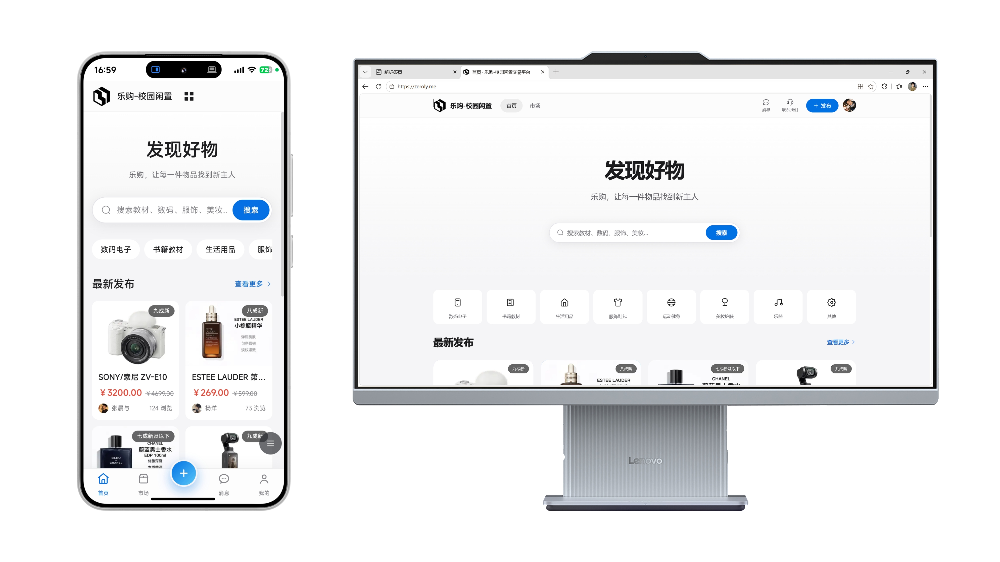 |  |
| **首页** | **逛市场** |
| 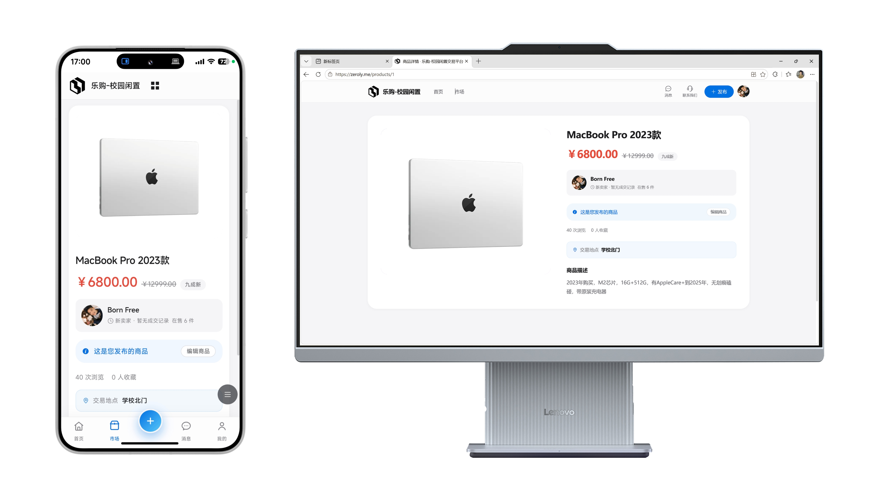 | 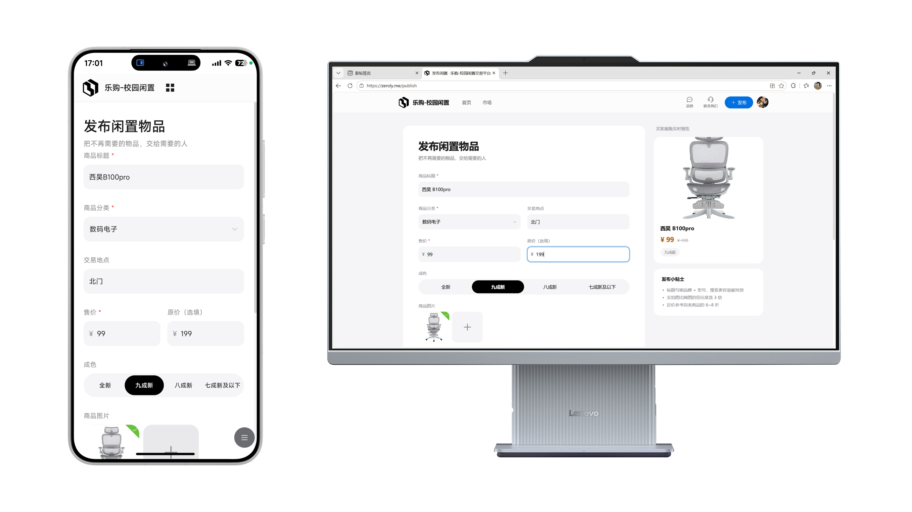 |
| **商品详情** | **发布闲置** |
| 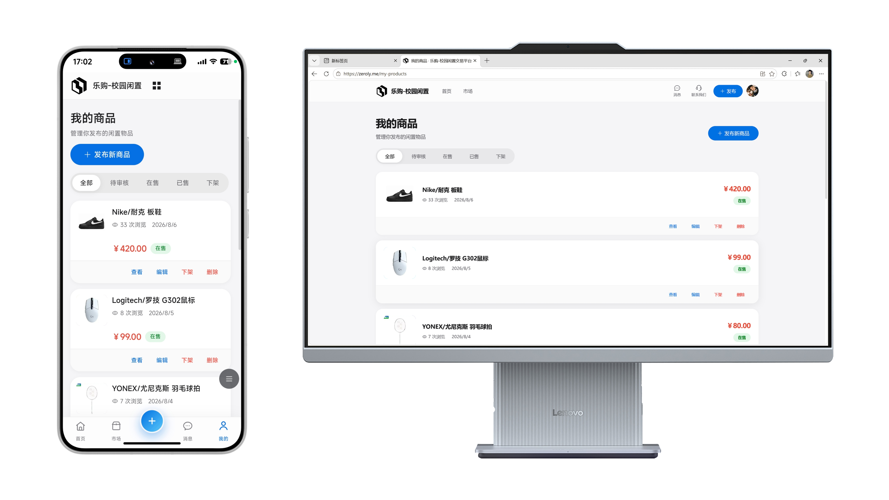 | 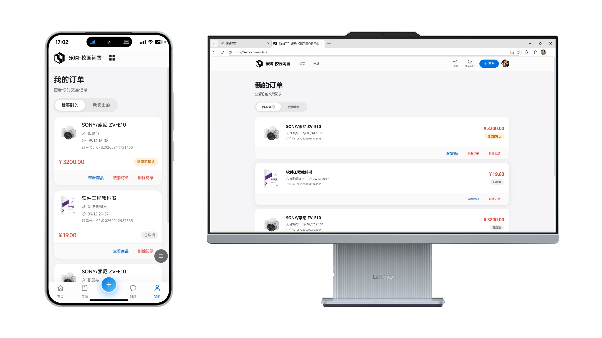 |
| **我的商品** | **我的订单** |
| 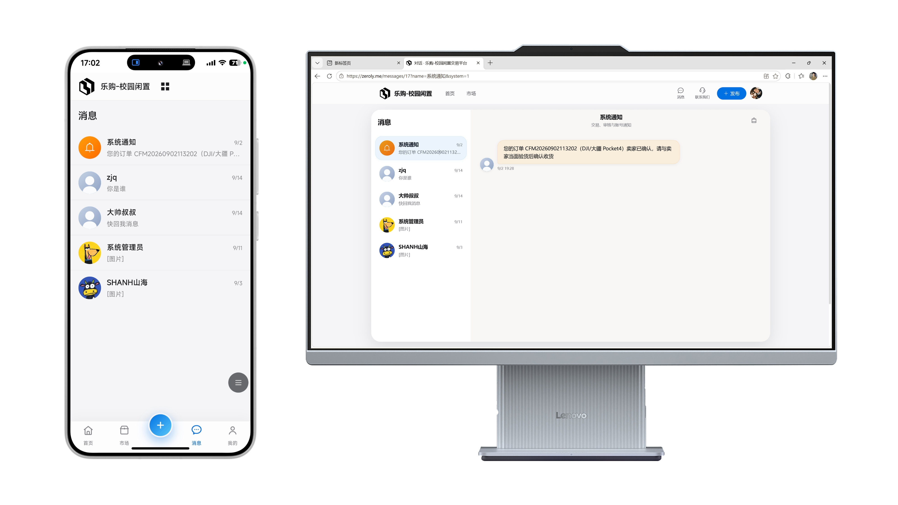 | 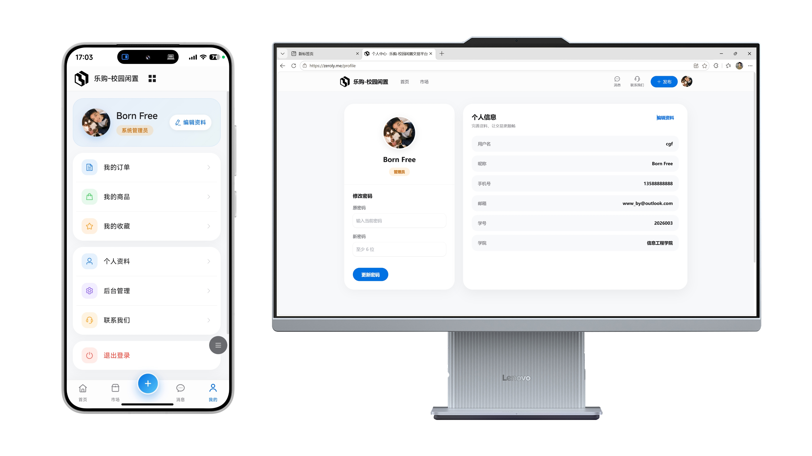 |
| **消息中心** | **个人中心** |

### 管理后台

| | |
|---|---|
| 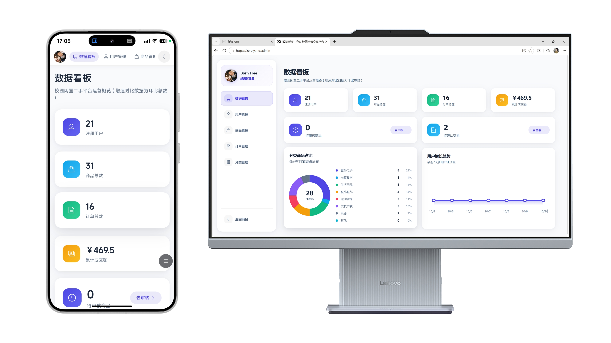 | 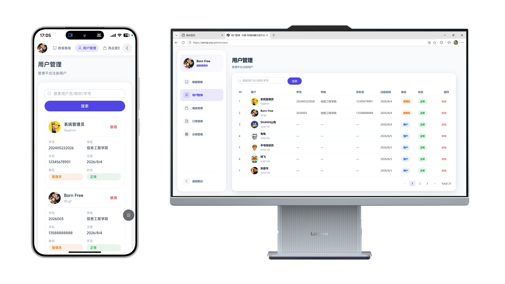 |
| **数据看板** | **用户管理** |
| 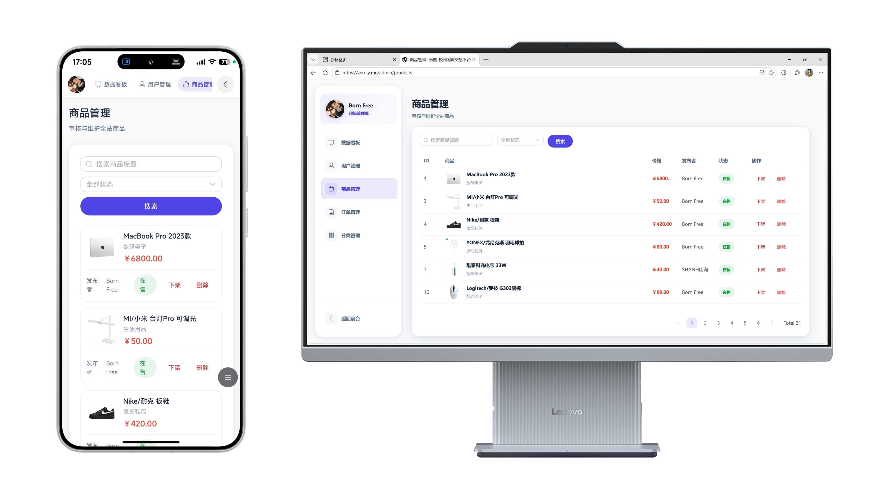 | 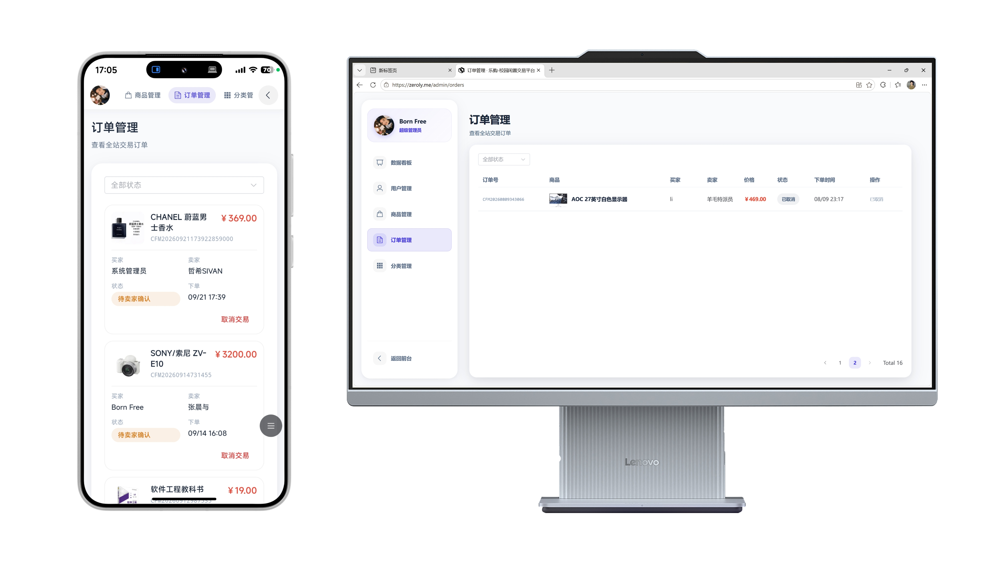 |
| **商品管理** | **订单管理** |

---

## 技术栈

### 前端（`client/`）
- **Vue 3.4** + Composition API + `<script setup>`
- **Vite 5** 构建
- **Vue Router 4** + **Pinia 2** 状态管理
- **Element Plus 2.7** UI 组件
- **Axios** HTTP 客户端，统一拦截器处理 401
- **jsencrypt** RSA 公钥加密登录密码

### 后端（`server/`）
- **Node.js 18+** + **Express 4.19**
- **Sequelize 6** + **mysql2** ORM
- **JWT**（jsonwebtoken）鉴权，载荷 `{id, username, role}`
- **bcryptjs** 密码哈希
- **multer + sharp** 文件上传 + 图片压缩 + 魔数校验
- **ip2region** 离线 IP 归属地库 + **ua-parser-js** 设备识别
- **helmet / cors / compression / express-rate-limit** 安全与限流

### 数据库
- **MySQL 8.0**，10 张表：用户 / 商品 / 订单 / 分类 / 收藏 / 消息 / 轮播
  + 访问事件 / 访问会话 / 设备型号别名

---

## 目录结构

```
campus-flea-market/
├── client/                  # 前端 (Vue 3 + Vite)
│   ├── src/
│   │   ├── views/           # 页面级组件（Home / ProductList / UserProfile / ...）
│   │   ├── views/admin/     # 管理后台（含 VisitAnalysis 访问分析）
│   │   ├── components/      # FloatTabBar 移动端悬浮导航等
│   │   ├── composables/     # 组合式函数
│   │   ├── router/          # 路由（TabLayout 分层 + 登录态守卫）
│   │   ├── stores/          # Pinia stores
│   │   ├── utils/           # axios 实例、加密、埋点
│   │   └── App.vue / main.js
│   ├── vite.config.js
│   └── package.json
├── server/                  # 后端 (Express)
│   ├── src/
│   │   ├── controllers/     # 10 个业务控制器（含 user / visit）
│   │   ├── models/          # Sequelize 模型（含 VisitEvent / VisitSession）
│   │   ├── routes/          # 路由聚合 + 接口限流
│   │   ├── middleware/      # 鉴权、上传、访问采集
│   │   └── utils/           # 响应、IP 归属地、UA 解析、图片校验、搜索扩展
│   ├── scripts/             # 索引优化 / 图片压缩 / 运行状态检查
│   ├── keys/                # RSA 公私钥（不在 git）
│   └── .env.example         # 环境变量样例
├── database/
│   └── init.sql             # 初始 schema
├── docs/screenshots/        # 截图
├── start.bat                # Windows 一键启动
├── .gitignore
└── README.md
```

---

## 快速开始

### 环境要求
- Node.js ≥ 18
- MySQL 8.0+
- npm 或 pnpm

### 1. 克隆 & 安装
```bash
git clone https://github.com/CGF-Beep/campus-flea-market.git
cd campus-flea-market

# 后端
cd server && npm install && cd ..

# 前端
cd client && npm install && cd ..
```

### 2. 初始化数据库
```bash
mysql -u root -p < database/init.sql
```

### 3. 配置环境变量
```bash
cd server
cp .env.example .env
# 编辑 .env，填入 MySQL 密码、JWT 密钥、端口等
```

### 4. 启动
```bash
# 方式一：一键启动（Windows）
双击 start.bat

# 方式二：分别启动
cd server && npm start          # 后端 → http://localhost:3000
cd client && npm run dev        # 前端 → http://localhost:5173
```

打开浏览器访问 <http://localhost:5173> 即可。

---

## 环境变量

参考 `server/.env.example`（**注意：`.env` 已被 `.gitignore` 屏蔽，私钥亦不会进入仓库**）：

| 变量 | 必填 | 说明 |
|---|---|---|
| `PORT` | ✓ | 后端监听端口，默认 3000 |
| `JWT_SECRET` | ✓ | JWT 签名密钥，**生产环境务必使用 64 位随机串** |
| `JWT_EXPIRES` | ✓ | Token 过期时间，如 `7d` |
| `DB_HOST` / `DB_PORT` / `DB_NAME` / `DB_USER` / `DB_PASSWORD` | ✓ | MySQL 连接信息 |
| `UPLOAD_DIR` | ✓ | 文件上传目录，默认 `src/uploads` |
| `CLIENT_URL` | ✓ | 前端地址，用于 CORS 与回调 |
| `TRUST_PROXY` | ✗ | 位于 Nginx / CDN 之后时设为 `true`，否则保持 `false` |
| `CLOUDFLARE_PROXY` | ✗ | 域名挂 Cloudflare 橙云时设为 `true`，客户端 IP 取 `CF-Connecting-IP` |

> ⚠️ **访问分析相关**：`TRUST_PROXY=true` 时 Nginx 必须注入
> `X-Real-IP` / `X-Forwarded-For`，否则所有访客 IP 都会记成 `127.0.0.1`，
> 访问分析里的地区统计与 UV 会全部失真。详见 `server/.env.example` 注释。

---

## 线上部署

```
浏览器
  ↓ HTTPS（Cloudflare 完整/严格模式 + Origin CA 证书）
Cloudflare（橙云代理）
  ↓ 443
Nginx（app.zeroly.me → 前端静态目录；api.zeroly.me → 127.0.0.1:3000）
  ↓
Node.js (Express) + MySQL
```

- 前端：`vite build` 后静态托管，Nginx 直接 `root`
- 后端：Node 常驻 + Nginx 反向代理，`TRUST_PROXY` / `CLOUDFLARE_PROXY` 按链路开启
- 运维脚本：`server/scripts/add-indexes.js`（索引）、`optimize-legacy-images.js`（存量图片瘦身）、
  `server/src/utils/cleanOrphanUploads.js`（孤儿文件清理）

---

## 在线演示

- 前端：<https://app.zeroly.me>
- 测试账号：登录页直接注册即可（同校信任圈，学号需 12 位、手机号 11 位 1 开头）
- 管理员账号可在数据库 `users` 表中自行将 `role` 字段改为 `admin` 后登录 `/admin`

---

## License

MIT © 2026 陈钢峰
